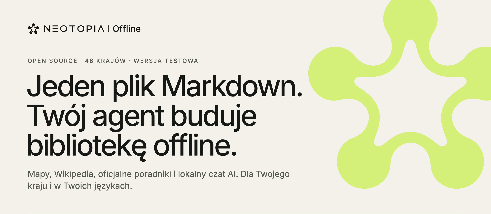
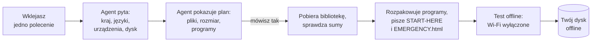
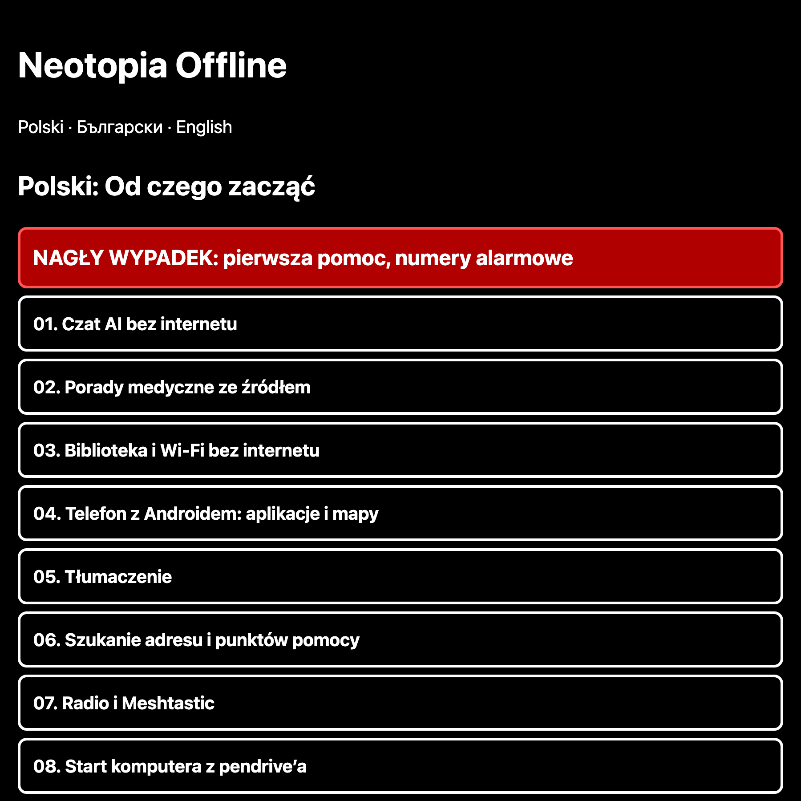
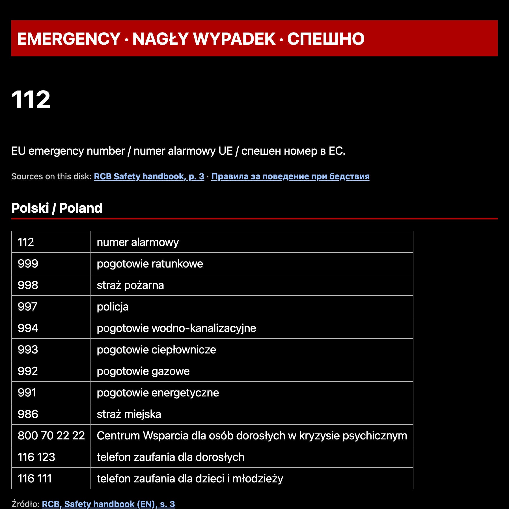
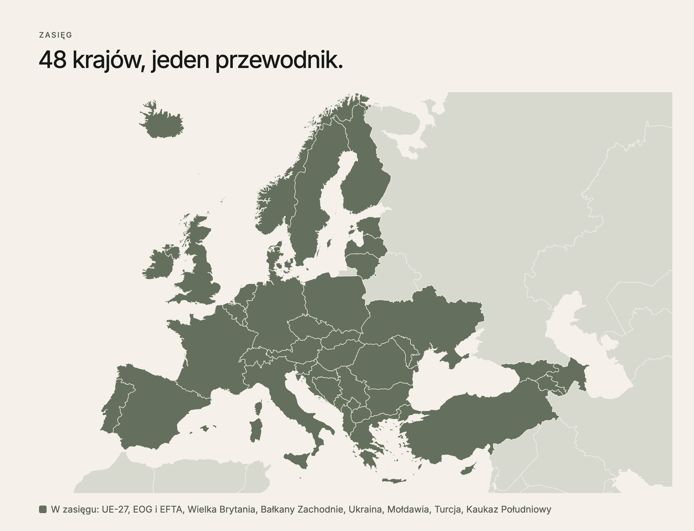
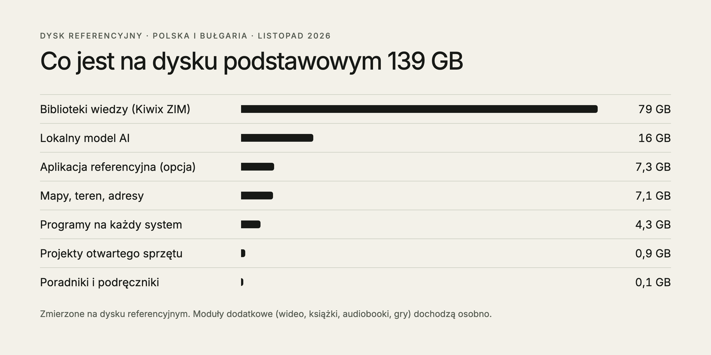

<picture>
  <source media="(prefers-color-scheme: dark)" srcset="docs/img/hero-dark-pl.png">
  
</picture>

<p align="center">
  <a href="LICENSE.md"></a>
  <a href="LICENSE.md"></a>
  
  
  
  
</p>

<p align="center">
  <b>Daj swojemu agentowi AI jeden plik Markdown. Agent zbuduje bibliotekę offline dla Twojej części Europy.</b><br>
  Gdy zabraknie sieci, domownicy nadal otworzą mapy, przeszukają Wikipedię i przeczytają oficjalne poradniki.
</p>

<p align="center">
  <a href="#start">Start</a> ·
  <a href="#jak-to-działa">Jak to działa</a> ·
  <a href="#co-działa-bez-internetu">Co działa offline</a> ·
  <a href="#czego-potrzebujesz">Czego potrzebujesz</a> ·
  <a href="#pobieranie-i-kontrola">Zaufanie</a> ·
  <a href="neotopia-offline.md">Przewodnik</a> ·
  <a href="README.md">English</a>
</p>

Wersja testowa od Fundacji Neotopia.

<!-- DEMO: 20-sekundowy GIF. Agent pokazuje plan i czeka na „tak”. Cięcie: „Po zbudowaniu”. Wi-Fi wyłączone. Otwiera się artykuł w Kiwix i mapa w OsmAnd. -->

## Start

**1. Pobierz przewodnik i sprawdź go.** Użyj wersji wydanej. Porównaj sumę kontrolną z tą w [opisie wydania](https://github.com/neotopia-foundation/offline/releases).

```sh
# macOS i Linux
curl -LO https://github.com/neotopia-foundation/offline/releases/download/v0.1.0/neotopia-offline.md
shasum -a 256 neotopia-offline.md
```

```powershell
# Windows PowerShell
curl.exe -LO https://github.com/neotopia-foundation/offline/releases/download/v0.1.0/neotopia-offline.md
Get-FileHash neotopia-offline.md
```

**2. Uruchom agenta w tym folderze.** Claude Code, Codex, Gemini CLI albo inny agent, który wykonuje polecenia.

**3. Wklej to polecenie.**

```text
Przeczytaj mój lokalny plik neotopia-offline.md.
Zadaj mi pytania o konfigurację.
Pokaż folder docelowy, listę plików i szacowany rozmiar.
Wypisz programy, które musisz zainstalować.
Zaczekaj na moją zgodę, zanim zainstalujesz programy albo pobierzesz bibliotekę.
Potem zbuduj dysk i pomóż mi sprawdzić go bez internetu.
```

Agent zapyta o kraj, języki, urządzenia, wolne miejsce i limit danych. Agent w chmurze przesyła Twoje odpowiedzi do swojego dostawcy. Nie podawaj w tej rozmowie prywatnych danych medycznych.

**Bez agenta?** Dla Polski jest gotowa lista plików i skrypt pobierania w [no-agent/](no-agent/README.pl.md). Dostajesz pliki, ale bez stron startowych i skryptów, które pisze agent.

## Jak to działa



Biblioteka pobiera się dopiero po Twoim „tak”. Wcześniej agent może sprawdzić w sieci aktualne nazwy i rozmiary plików. Przewodnik nic nie wysyła do fundacji.

## Co działa bez internetu

- **Mapy.** Znajdziesz ulicę w OsmAnd na telefonie. Sprawdzisz ujęcia wody, apteki i szpitale, które naniesiono na OpenStreetMap.
- **Wikipedia i poradniki.** Przeszukasz Wikipedię, artykuły medyczne i poradniki naprawy sprzętu w Kiwix. Jeden laptop udostępni je telefonom w lokalnej sieci Wi-Fi.
- **Poradniki na sytuacje kryzysowe.** Krajowe zalecenia tam, gdzie istnieją, materiały o pierwszej pomocy i wytyczne UE dotyczące co najmniej 72 godzin samowystarczalności.
- **Lokalny czat AI.** Skopiuj fragment z Kiwix i wklej go do czatu. Model go wyjaśni. Działa na Twoim komputerze i może się mylić. Zalecenia dotyczące pierwszej pomocy, leków i wody sprawdzaj w poradniku źródłowym.
- **Strony startowe.** `START-HERE.html` i `EMERGENCY.html` w językach domowników, ze skryptami startowymi i opisami krok po kroku.
- **Pakiet do druku.** Karta alarmowa, plan rodzinny i mapa okolicy. Papier działa bez prądu.

<table>
  <tr>
    <td width="50%"></td>
    <td width="50%"></td>
  </tr>
  <tr>
    <td><sub><b>START-HERE.html</b> na dysku referencyjnym. Jedna strona, trzy języki, piętnaście zadań.</sub></td>
    <td><sub><b>EMERGENCY.html</b>. Każdy numer prowadzi do strony oficjalnego poradnika na dysku.</sub></td>
  </tr>
</table>

<picture>
  <source media="(prefers-color-scheme: dark)" srcset="docs/img/coverage-dark-pl.png">
  
</picture>

Zasięg: UE-27, EOG i EFTA, Wielka Brytania, Bałkany Zachodnie, Ukraina, Mołdawia, Turcja i Kaukaz Południowy. Dostępne poradniki i wersje Wikipedii zależą od kraju i języka. [Mapy według krajów](neotopia-offline.md#14-country-map-table) · [Języki](neotopia-offline.md#15-language-packs) · [Poradniki krajowe](neotopia-offline.md#16-national-preparedness-guides)

## Czego potrzebujesz

- Internetu na czas budowy. Potem dysk działa bez sieci.
- Bash, `curl` oraz `shasum` albo `sha256sum`. macOS i Linux je mają. Na Windows agent potrzebuje środowiska Bash, na przykład WSL. Budowy na Windows jeszcze nie testowaliśmy.
- Dysku albo folderu z wystarczającą ilością miejsca. System plików exFAT działa na macOS, Windows i Linux.
- Czasu. Pobieranie trwa zależnie od łącza. Pełne sprawdzenie sum dla 114 GB zajęło około godziny na dysku USB 3.
- Kosztów: dysk, transfer danych i opłaty za agenta AI, jeśli są. Sam przewodnik jest bezpłatny.

| Dysk | Typowa zawartość |
|---|---|
| **32 GB** | Programy, mały model AI, encyklopedie medyczne i praktyczne, skrócona Wikipedia, mapy na telefon, poradniki. Cel: 25 GB |
| **128 GB** | Do tego większy model AI, pełna Wikipedia bez ilustracji, poradniki naprawy sprzętu, teren, adresy |
| **256 GB** | Do tego podręczniki naukowe, mapy krajów sąsiednich, książki i audiobooki |
| **512 GB i więcej** | Do tego Wikipedia z ilustracjami, duże zbiory książek, kilka krajów |

Zostaw 10% dysku wolnego. Agent dobiera model AI do pamięci Twojego komputera. [Profile rozmiarów](neotopia-offline.md#3-size-tiers)

## Pobieranie i kontrola

- **Bez konta i telemetrii.** Nie potrzebujesz konta w Neotopii. Przewodnik nic nie wysyła do fundacji.
- **Źródła.** Manifest wymienia każde źródło. Większość plików pochodzi od wydawców. Część pochodzi z serwerów lustrzanych, a duże archiwa Kiwix także od innych użytkowników przez BitTorrent.
- **BitTorrent.** Gdy masz `aria2c`, archiwa Kiwix od 1 GB idą przez BitTorrent. To odciąża darmowe serwery Kiwix. Podczas pobierania Twój komputer wysyła fragmenty plików innym. Bez `aria2c` wszystko idzie przez HTTP.
- **Sumy kontrolne.** Skrypt pobierający sprawdza sumy wydawcy dla archiwów Kiwix. Agent sprawdza inne pliki tam, gdzie wydawca publikuje sumy. Na koniec zapisuje `SHA256SUMS.txt` dla całego dysku.
- **Błędy.** Zakończone pobieranie może mieć nieudane pozycje. Przeczytaj `_log/failed.tsv`. Porównaj dysk z `MANIFEST.tsv`. [Szczegóły pobierania](neotopia-offline.md#121-fetchsh-resumable-downloader)

<details>
<summary>Polecenia, którym warto się przyjrzeć</summary>

Skrypt startowy czatu na Macu zdejmuje z pobranego programu AI blokadę kwarantanny macOS, żeby program mógł ruszyć. Opcjonalny instalator Ventoy kasuje docelowy pendrive. Przewodnik każe agentowi nazwać ten pendrive i zaczekać na Twoje potwierdzenie. [Skrypty startowe](neotopia-offline.md#315-launcher-templates) · [Bezpieczeństwo dysku](neotopia-offline.md#3010-disk-security-and-phones)

</details>

## Sprawdź dysk

1. Wyłącz Wi-Fi, dane komórkowe i Bluetooth. Otwórz mapę, artykuł w Wikipedii i krajowy poradnik na najsłabszym urządzeniu w domu.
2. Odłącz kabel internetu od routera, a lokalne Wi-Fi zostaw włączone. Otwórz artykuł z Kiwix na drugim urządzeniu.

Agent zapisze wyniki w `_log/drill.txt`. Każde zadanie, które wybierzesz, musi przejść. [Pełny test offline](neotopia-offline.md#274-offline-drill)

## Dysk referencyjny

<picture>
  <source media="(prefers-color-scheme: dark)" srcset="docs/img/drive-dark-pl.png">
  
</picture>

W listopadzie 2026 zbudowaliśmy dysk dla Polski i Bułgarii. Jego część podstawowa ma 309 plików i 139 GB. Pięć plików PDF się nie pobrało, bo serwery zwróciły błąd 403 albo 404. Po budowie wszystkie pliki części podstawowej przeszły pełne sprawdzenie z listą sum zapisaną na dysku. Model AI zgadzał się też z sumą wydawcy.

Na Macu z procesorem Apple i 16 GB pamięci mały model AI uruchomił się z pendrive'a w około cztery minuty. Jedna staranna odpowiedź trwała około pięciu minut. [Wnioski z budowy](neotopia-offline.md#17-lessons-from-the-reference-build)

## Udostępnianie

Pobrane materiały zachowują własne licencje. Zanim skopiujesz dysk dla innych, sprawdź każdą pozycję i usuń pliki osobiste. Jeśli warunki są niejasne, udostępnij link albo zapytaj wydawcę. [Zasady udostępniania](neotopia-offline.md#13-licences-and-law)

## Jak pomóc

Najbardziej pomagają raporty z budowy dysku: rzeczywisty rozmiar i wyniki testu offline. Potem nowe poradniki krajowe i zgłoszenia martwych linków. [CONTRIBUTING.md](CONTRIBUTING.md)

## Projekty pokrewne

[Kiwix](https://kiwix.org) robi czytnik offline, którego używa ten przewodnik. [Internet-in-a-Box](https://internet-in-a-box.org/) to wspólna biblioteka w sieci Wi-Fi na małym serwerze. [Lastbook](https://github.com/Immortal-Protocols/lastbook) to aplikacja na komputer dla Stanów Zjednoczonych. Jej czat przeszukuje własny zbiór. Zainspirowała ten niezależny projekt europejski. Neotopia Offline nie jest oficjalną edycją Lastbook.

## Licencja

Tekst: CC BY 4.0. Kod: MIT. Fundacja Neotopia. Szczegóły: [LICENSE.md](LICENSE.md) · [CREDITS.md](CREDITS.md) · [SECURITY.md](SECURITY.md)

Dane mapy: Natural Earth (domena publiczna), granice w ujęciu polskim.
